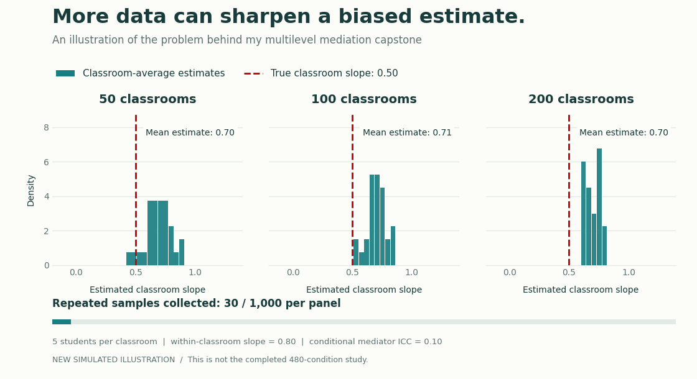

## Research spotlight

My capstone investigates estimation in 2-1-1 multilevel mediation.

**480 simulation conditions · 5,000 repetitions per condition · 2.4 million sampled datasets**

I’m an M.S. student in Data Science in Human Behavior at UW–Madison. I like questions where people, data, and models meet. My work spans educational data analysis, neural networks for text classification, and Monte Carlo simulation of multilevel models.

## Currently

- 🎓 Finishing my M.S. in Data Science in Human Behavior (December 2026)
- 🔭 Starting a PhD in Industrial Engineering - Human Factors & Ergonomics (January 2027)
- 🔎 Interested in: Machine Learning with humans in mind, sports analytics, natural language processing
  

## Featured work

| Project | What it explores | Built with |
| --- | --- | --- |
| [**Multilevel mediation simulation**](https://github.com/emilyhuffaker/capstone-simulation) | Comparing regression and latent-variable estimation in 2–1–1 multilevel mediation through Monte Carlo simulation: 480 conditions with 5,000 repetitions each. | R, lavaan, HTCondor, Apptainer |
| [**Predicting behavior from text · DAGE**](https://github.com/emilyhuffaker/DAGE) | Using semantic features and neural networks to predict communication apprehension and transportation-use categories from open-ended survey responses. | Python, TensorFlow/Keras, scikit-learn |
| [**Student affect and learning · Carnegie Learning**](https://github.com/emilyhuffaker/Carnegie_Learning_DSHB26) | Investigating how observed concentration, boredom, and confusion relate to student-level learning quality and individual assessment-attempt scores. | Python, Quarto |

## Toolbox

**Languages**

**Data and statistics**

**Machine learning**

**Visualization and reporting**

**Environments and workflow**

## Background

| | |
| --- | --- |
| **Education** | M.S. Data Science in Human Behavior, UW–Madison |
| **Interests** | Machine learning, NLP, statistical modeling, human-centered data science |

## Activity

<picture>
  <source media="(prefers-color-scheme: dark)" srcset="https://raw.githubusercontent.com/emilyhuffaker/emilyhuffaker/output/github-snake-dark.svg">
  
</picture>
